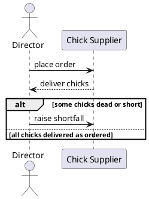

# Writing `6-sequence-diagram.md`

The rubric row (Requirements item 7, 10 points, verbatim from `resources/md/Coursework-01-group-v2.md`):

> There are four processes documented correctly: 4 points. The diagram is using all shapes correctly: 6 points. The diagram doesn't use the standard notation: -5 points.

Plus the requirement text: "Produce Sequence Diagram for four main functions/processes."

This module's own teaching material on sequence-diagram notation (`resources/md/SAD-Tutorial-04.md`) is thin — a shapes slide citing a generic external UML reference, plus three practice scenarios (login, e-commerce checkout, module enrolment). There is no house-specific notation to diverge from here, unlike DFDs. The authoritative standard is therefore **standard UML sequence diagram notation**, rendered as PlantUML per this repo's diagram convention (`CLAUDE.md`).

## Reuse the four use cases already defined — don't invent new ones

`3-use-cases.md` already defines exactly four use cases (UC-01 Order Day-Old Chicks, UC-02 Decide Main Slaughter Date, UC-03 Run Main Slaughter, UC-04 Sell Meat to Bazaar Agent), each with named actors (Director, Chick Supplier, Slaughter Crew, Bazaar Agent) and a numbered basic flow. Each sequence diagram should trace to exactly one of these four, reusing the same actor names and the same step logic — not a generic or invented interaction that happens to sound similar.

- ❌ A sequence diagram for "ordering supplies" with a generic "Supplier" actor.
- ✅ A sequence diagram for UC-01 "Order Day-Old Chicks" with lifelines for `Director` and `Chick Supplier`, whose message sequence follows UC-01's four basic-flow steps in order.

This also satisfies the rubric's "four processes documented correctly" (4 pts) in the least ambiguous way possible: a marker checking this section against section 3 sees an exact match, not a judgment call about whether a new scenario "counts."

## Represent documented extensions as `alt`/`opt` frames, not silently

Three of the four use cases have a documented alternate flow that matters:
- UC-01 4a: chicks arrive dead or short — supplier bears the loss.
- UC-02 3a: batch not yet ready — the Director waits and resamples.
- UC-03 7a: no birds remain — the crew is not called back.

A sequence diagram that only shows the happy path silently drops information the group already gathered and wrote up elsewhere. Use PlantUML's `alt`/`else`/`end` (or `opt`/`end` for a single branch) to show the branch, not a caption describing it in prose.



## Use the correct arrow for a call vs. a return — this is the most common real error

UML distinguishes a synchronous call (solid line, filled arrowhead, `->`) from its return (dashed line, open arrowhead, `-->>` in PlantUML). Using the same arrow style for both is the single most common sequence-diagram mistake, and it is exactly what the rubric's "-5: doesn't use the standard notation" penalty is aimed at. For a multi-step exchange like UC-04 (price agreed, meat sent, weighed, photographed, checked, paid, recorded), show the call messages and the return/confirmation messages with visibly different arrow types, not one uniform arrow for every line.

## Activation bars for anything that takes real work, not just a flat lifeline

A flat lifeline with no activation bar implies the participant is idle until the next arrow arrives, which is wrong for e.g. the Slaughter Crew's multi-step overnight session in UC-03 (kill → scald → pluck → clean) or the Bazaar Agent's weigh-and-photograph sequence in UC-04. Use `activate`/`deactivate` around the span where a participant is actually doing something, not just receiving and immediately replying.

## Self-review checklist

- [ ] Exactly four diagrams, each tracing to one of UC-01 through UC-04 in `3-use-cases.md`, reusing the same actor names.
- [ ] Every synchronous call uses a solid line + filled arrowhead (`->`); every return/confirmation uses a dashed line + open arrowhead (`-->>`) — never the same style for both.
- [ ] Activation bars mark any participant doing multi-step work, not just a flat lifeline for the whole diagram.
- [ ] Each use case's documented alternate flow (UC-01 4a, UC-02 3a, UC-03 7a) appears as an `alt`/`opt` frame where it exists, not dropped or only mentioned in prose.
- [ ] Diagrams are fenced ` ```plantuml ` blocks per this repo's convention (`CLAUDE.md`), not external images.
- [ ] No prose paragraph explains what a sequence diagram *is* as a concept (`analytical-writing`'s rule) — captions name the use case and point to anything non-obvious (e.g. why a branch exists), nothing more.

For notation and rubric scoring, use the `sequence-diagram-assessor` subagent (scoped to this section) rather than the generic `rigorous-assessor`. For any surrounding prose register, re-run `analytical-writing`'s checklist.
