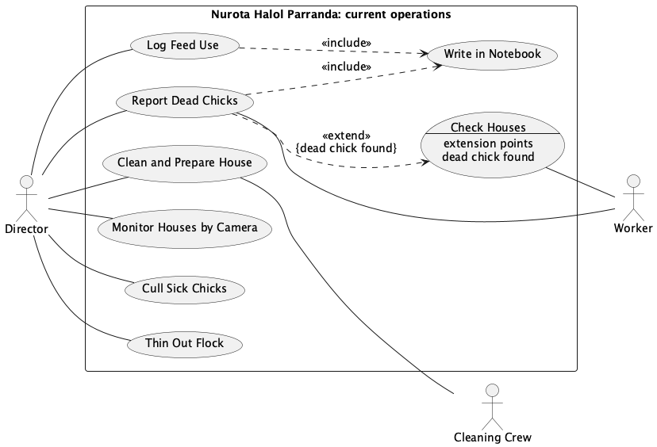
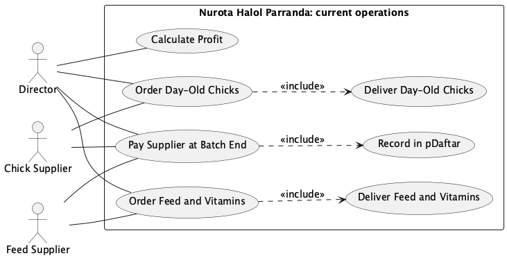
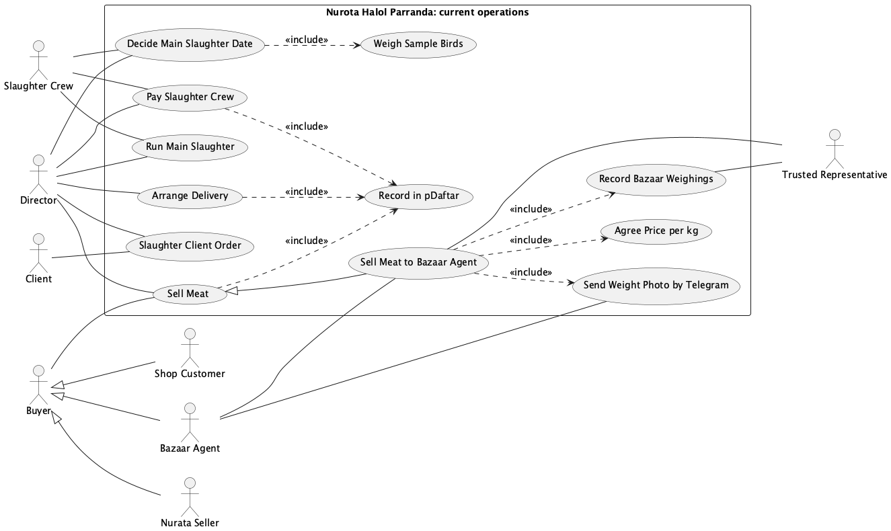

# Use Case Diagram

<!-- Rubric: resources/md/Coursework-01-group-v2.md, Requirements item 3 (10 points). -->

<!--
Scope: AS-IS (the farm's current manual process), per CLAUDE.md. The proposed system belongs in section 7 only.
One diagram drawn as three figures by stage of the batch (2026-10-26, Abdurahmon's choice: the single figure was too crowded):
diagrams/use-case-rearing.puml, use-case-procurement.puml and use-case-slaughter-sales.puml, each rendered to a PNG with Graphviz dot.
Re-render: java -jar tools/plantuml.jar -tpng diagrams/use-case-rearing.puml diagrams/use-case-procurement.puml diagrams/use-case-slaughter-sales.puml
26 unique use cases; Record in pDaftar appears in Figures 2.2 and 2.3. Recount "16 of the 26" across all three files after any edit.

Stated in 0-business-case.md: suppliers on contract; verbal death reports logged in the notebook with feed use; butcher paid per
head on a verbally agreed count; Bazaar Agent is a middleman who sends daily kg photos on Telegram and settles by cash or transfer;
pDaftar holds costs, revenue and profit.

Confirmed by Muzaffar but not (yet) in 0-business-case.md:
- 2026-10-24: per-kg price with the Bazaar Agent is agreed verbally each time; delivery driver for the meat run is a temporary hire
  arranged by the Director (not an actor); the Director checks the camera app (Monitor Houses by Camera).
- 2026-10-26 (interview): chicks come only from Tashkent; chicks and feed are bought under contract and paid when
  each batch ends; the suppliers deliver both; the agent is an independent middleman who pays a little below the bazaar rate;
  readiness is judged on age + random-sample average weight + experience; the number of slaughter sessions per batch is not fixed;
  birds are sold only as meat; amount owed = kg x price, and a second person from the farm also records the bazaar weighings.
  (2026-10-26: section 0 now says Tashkent; section 1 quotes 'mostly Tashkent - Tashkent, Guliston, the valley'; Abdurahmon confirmed Tashkent.)

Muzaffar's answers, 2026-10-26 (second round): weight mismatch with the agent 'no chance' (no exception added); houses are cleaned by
  temporarily hired employees (Cleaning Crew + Clean and Prepare House added, Director as goal owner); clients place small orders by
  direct communication; the bazaar person is 'anyone the director trusts' and also takes the cash; price is agreed BEFORE the meat leaves;
  crew disputes/no-shows: no answer; short or dead chicks are the chick supplier's responsibility (UC-01 exception 4a).
  FLAG for Nodir: sections 4-5 name a Worker as the bazaar recorder and put price agreement at the bazaar - both now contradicted.
Still open (no use case or actor added until confirmed):
- Who slaughters the ~4,000 birds at day 35-40, and who buys that meat?
- How do the Nurata seller and the shop customers receive the meat and pay?
- Who receives the chick delivery, and who feeds the birds?
- Is the batch-end supplier payment by bank transfer? (Confirmed 2026-10-26: paid under contract at batch end.)
Step 0 decisions (2026-10-26): boundary = the farm's manual procedures and records, so Director and Workers are actors
(section 4 draws the boundary around the farm itself, hence they are inside there; reconciled in the visible text).
The Director is kept as one actor; his three roles (owner, production decider, record keeper) are stated as a finding.
Postpone Slaughter removed from the diagram: it restarts the decision rather than adding to it, so it is UC-02 extension 3a.
Calculate Profit (renamed from Calculate Batch Profit 2026-10-26: section 1 says pDaftar is not split by batch) only reads pDaftar.
2026-10-26 rename: "Pay Slaughter Crew per Head" -> "Pay Slaughter Crew" (section 0 says only the butcher is paid per head).
FLAG for Nodir: 4-data-flow-diagram.md line 33 still uses the old name.
UC-02 now lists the Slaughter Crew as secondary actor, so the diagram links Slaughter Crew to Decide Main Slaughter Date.
2026-10-26: added Record Bazaar Weighings (included by Sell Meat to Bazaar Agent) and the Trusted Representative actor
  ('anyone the director trusts' records the weighings and takes the cash); Bazaar Agent linked to Send Weight Photo by Telegram.
Reference names for sections 3-7: Director, Worker, Slaughter Crew, Cleaning Crew, Trusted Representative, Client, Chick Supplier, Feed Supplier, Buyer / Bazaar Agent / Nurata Seller / Shop Customer, and the use case names below.
-->

The diagram shows how Nurota Halol Parranda runs today, from ordering chicks to selling the meat, with no purpose-built information system: only a paper notebook, the pDaftar bookkeeping app, Telegram and a camera app. We drew the boundary around the farm's manual procedures and records rather than around the farm itself. That is why the Director and the Worker are actors here but sit inside the boundary in the section 4 DFD. The other actors are the two suppliers, the hired Slaughter Crew, the temporarily hired Cleaning Crew, the Trusted Representative, the buyers and the clients. The Bazaar Agent, the Nurata Seller and the Shop Customer are kinds of Buyer. A Client is drawn apart from them: clients order 50–100 birds by contacting the Director directly, and those birds are slaughtered in-house on demand, outside the main slaughter that feeds the three buyers. The delivery driver is also a temporary hire, but shows up only as a cost in Arrange Delivery, so the driver is not an actor.

The diagram is drawn in three parts, one for each stage of a batch. All three share the same system boundary, so they read as one diagram. Record in pDaftar appears in both Figure 2.2 and Figure 2.3, because both stages write to it.

*Figure 2.1: Use case diagram, part 1 of 3: rearing (as-is)*

*Figure 2.2: Use case diagram, part 2 of 3: procurement and accounts (as-is)*

*Figure 2.3: Use case diagram, part 3 of 3: slaughter and sales (as-is)*

The farm keeps two kinds of record and never joins them. Report Dead Chicks and Log Feed Use both include Write in Notebook. Paying the suppliers, paying the crew, arranging delivery and selling meat all include Record in pDaftar. Calculate Profit reads only pDaftar, where the Director's figures are pooled rather than split by batch (section 1), so no batch's profit can be set against the deaths and feed use behind it. In our sources, a house check leaves a record only when a dead chick is found, and that is the one point where Report Dead Chicks extends Check Houses.

Across the three figures, the Director is linked to 16 of the 26 use cases. In practice the farm's owner, production manager and bookkeeper are the same person. Three of his money decisions rest on judgement or a spoken agreement: the butcher's head count, the agent's price per kg, and the slaughter date, which he sets from the birds' age, a sample of about ten birds and his own experience. The butcher is paid per head, but every buyer pays per kilogram, and no record links the two. As a result, the farm cannot tell what slaughtering costs per kilogram sold. Under the supply contract, chicks and feed are paid for when the batch ends, and Pay Supplier at Batch End is drawn apart from ordering for that reason: a batch's chick and feed bills are settled when the batch ends, by which point its meat has normally been sold.

Sell Meat to Bazaar Agent is a special case of Sell Meat because it is the only sale whose steps our sources document: a price agreed verbally each time before the meat leaves, the agent's Telegram photo of the weights, and the farm's own record of the same weighings. Record Bazaar Weighings is the only point in the sales our sources document where the farm keeps its own copy of a figure that an outsider supplies. Its actor, the Trusted Representative, can be anyone the Director trusts, so this record has no fixed owner.
