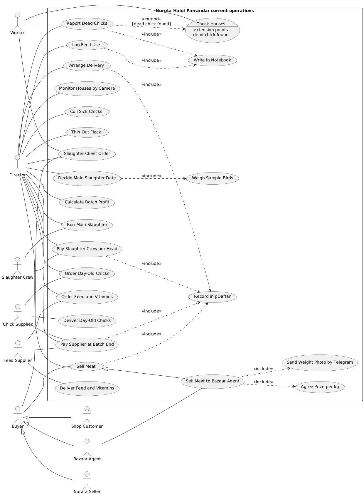

# Use Case Diagram

<!-- Rubric: resources/md/Coursework-01-group-v2.md, Requirements item 3 (10 points). -->

<!--
Scope: AS-IS (the farm's current manual process), per CLAUDE.md. The proposed system belongs in section 7 only.
One diagram, embedded as diagrams/use-case-diagram.png. Its source is diagrams/use-case-diagram.puml, rendered with Graphviz dot
(the pipeline's smetana engine cannot lay out 25 use cases legibly). Re-render: java -jar tools/plantuml.jar -tpng diagrams/use-case-diagram.puml

Stated in 0-business-case.md: suppliers on contract; verbal death reports logged in the notebook with feed use; butcher paid per
head on a verbally agreed count; Bazaar Agent is a middleman who sends daily kg photos on Telegram and settles by cash or transfer;
pDaftar holds costs, revenue and profit.

Confirmed by Muzaffar but not (yet) in 0-business-case.md:
- 2026-10-24: per-kg price with the Bazaar Agent is agreed verbally each time; delivery driver for the meat run is a temporary hire
  arranged by the Director (not an actor); the Director checks the camera app (Monitor Houses by Camera).
- 2026-10-26 (interview): chicks come only from Tashkent; chicks and feed are bought on credit (nasiya) under contract and paid when
  each batch ends; the suppliers deliver both; the agent is an independent middleman who pays a little below the bazaar rate;
  readiness is judged on age + random-sample average weight + experience; the number of slaughter sessions per batch is not fixed;
  birds are sold only as meat; amount owed = kg x price, and a second person from the farm also records the bazaar weighings.
  NOTE for Muzaffar: 0-business-case.md still says "Samarkand or Tashkent" and "standing contract paid by bank transfer" - update it.

Still open (no use case or actor added until confirmed):
- Who slaughters the ~4,000 birds at day 35-40, and who buys that meat?
- Who places the 50-100-bird client orders (one of the three buyers, or a fourth channel)?
- How do the Nurata seller and the shop customers receive the meat and pay?
- Who cleans and prepares a house between batches, who receives the chick delivery, and who feeds the birds?
- Who is the "second person from our side" at the bazaar? Is the batch-end supplier payment still by bank transfer?
Step 0 decisions (2026-10-26): boundary = the farm's manual procedures and records, so Director and Workers are actors
(section 4 draws the boundary around the farm itself, hence they are inside there; reconciled in the visible text).
The Director is kept as one actor; his three roles (owner, production decider, record keeper) are stated as a finding.
Postpone Slaughter removed from the diagram: it restarts the decision rather than adding to it, so it is UC-02 extension 3a.
Calculate Batch Profit no longer includes Record in pDaftar: it only reads it.
Reference names for sections 3-7: Director, Worker, Slaughter Crew, Chick Supplier, Feed Supplier, Buyer / Bazaar Agent / Nurata Seller / Shop Customer, and the use case names below.
-->

The diagram shows how Nurota Halol Parranda works today, from ordering chicks to selling the meat, without any computer system. The boundary is the farm's manual procedures and records, so the Director and the Workers, who use them, are drawn as actors; section 4 draws its boundary around the farm itself, which is why the same two people sit inside it there. Outside the farm are the two suppliers, the hired Slaughter Crew and the buyers. The Bazaar Agent, the Nurata Seller and the Shop Customer are drawn as kinds of Buyer, and Buyer also places the small client orders, because the farm has not said which buyers these are. House cleaning between batches is not drawn, because the farm has not said who does it, and the Delivery Driver is not an actor, because he is a temporary hire who appears only as a cost in Arrange Delivery.

*Figure 2.1: Use case diagram of the farm's current (as-is) operations*

The farm keeps two kinds of record and never joins them. Report Dead Chicks and Log Feed Use both include Write in Notebook, while paying the suppliers, paying the crew, arranging delivery and selling meat all include Record in pDaftar. Calculate Batch Profit reads only pDaftar, so a batch's profit is never set against the deaths and feed use that explain it. A house check leaves a record only when it finds a dead chick, which is why Report Dead Chicks extends Check Houses at that one point.

The Director is linked to 15 of the 24 use cases. He orders, decides when to cull, thin and slaughter, pays, sells and keeps both records, so the farm's owner, production manager and bookkeeper are one person. Two of his money decisions rest on figures agreed only by word of mouth, the butcher's head count and the agent's price per kg, and a third, the slaughter date, rests on a sample of about ten birds and his own experience. The crew is paid per head while every buyer pays per kg, and no record links the two, so the farm cannot tell what processing costs per kilogram sold. Chicks and feed are bought on credit, which is why Pay Supplier at Batch End is separate from ordering, and a batch's chick and feed costs are settled only after its meat has been sold.

Sell Meat to Bazaar Agent is drawn as a special case of Sell Meat because only this sale has steps of its own: the price agreed by word of mouth and the Telegram weight photo. It is also the only place where the farm checks a figure given to it by an outsider, because someone from the farm records the same weighings as the agent.
