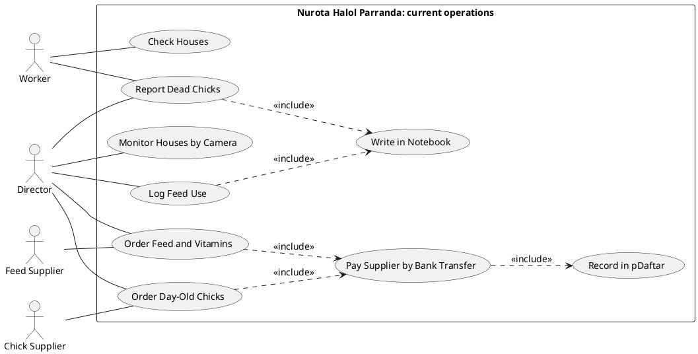
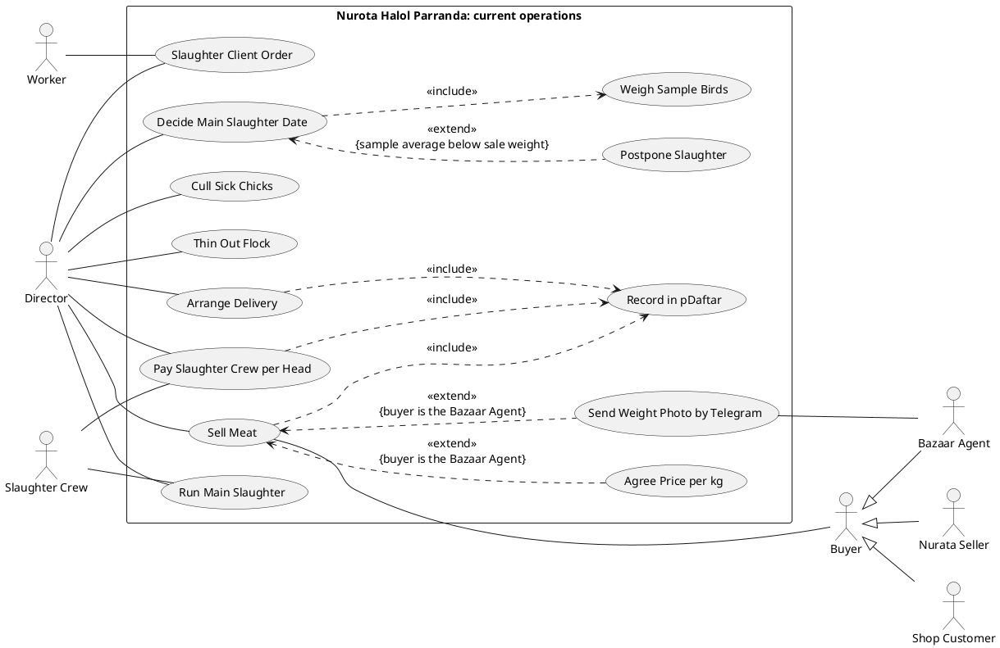

# Use Case Diagram

<!-- Rubric: resources/md/Coursework-01-group-v2.md, Requirements item 3 (10 points). -->

<!--
Scope: AS-IS (the farm's current manual process), per CLAUDE.md. The proposed system belongs in section 7 only.
Drawn as two views of one boundary because 20 use cases and 9 actors cannot be laid out legibly in one PlantUML picture.

Confirmed by Muzaffar (2026-10-24), beyond what 0-business-case.md states:
- Dead-chick count: workers tell the Director verbally; the Director writes it in his one paper notebook (the same notebook as feed use and everything else).
- Bazaar Agent: writes each weight in his own notebook, sums it, sends a photo of the page to the Director on Telegram; pays the same evening, cash or bank transfer. Per-kg price agreed verbally each time, following that day's bazaar rate.
- Chick and feed suppliers: both under contract, paid by bank transfer.
- Delivery driver (for the meat run to the bazaar, per the earlier business-case draft): a temporary hire arranged by the Director; not an actor.
- Cameras: the earlier business-case draft said the Director checks the camera app remotely (Monitor Houses by Camera).
- Slaughter crew: butchers count the birds themselves because they are paid per head; the count is agreed verbally, never written down.
- pDaftar holds costs AND sales income (0-business-case.md says only costs - Muzaffar to update).

Still open:
- Who slaughters the ~4,000 birds at day 35-40: the hired crew, or the Director and workers?
- How do the Nurata seller and the house-shop customers pay and receive their meat?
- Do workers record anything when they check a house?
- Who are the 50-100-bird "client orders" for: one of the three buyers, or a fourth channel? (Slaughter Client Order has no buyer link yet)
- Is the whole crew paid per head, or only the butcher(s)?
- Who cleans and prepares a house between batches, and who receives the chick delivery? (no use case yet)
- Is the per-kg price also agreed with the Nurata seller, and how is the shop price set? (Agree Price per kg is limited to the Bazaar Agent)
Reference names for sections 3-7: Director, Worker, Slaughter Crew, Chick Supplier, Feed Supplier, Buyer / Bazaar Agent / Nurata Seller / Shop Customer, and the use case names below.
-->

*Figure 2.1: As-is use cases, part 1: procurement and daily production*

*Figure 2.2: As-is use cases, part 2: slaughter stages and sales*

Both figures share one boundary, the farm's current way of working, split at the point where the business case itself divides the cycle: procurement and daily production, then slaughter and sale. The farm has no computer system, so each use case is a manual task; some leave a record on paper, in pDaftar or on Telegram, and the diagrams' value is in showing which ones do and which do not.

Two includes expose the farm's central record-keeping problem. Report Dead Chicks and Log Feed Use both include Write in Notebook, because the Worker reports deaths verbally and the Director copies the figure into the same paper notebook as feed use. Paying suppliers, paying the crew, arranging delivery and selling meat all include Record in pDaftar instead, which is why that use case appears in both figures. Production data and money therefore sit in two stores that never meet, so no single record shows what a batch cost against what it earned. Two steps that decide money leave no record at all: the butchers' head count, which sets their pay, and the per-kg price agreed verbally with the Bazaar Agent at that day's bazaar rate.

The Director is linked to more use cases than any other actor because every decision passes through him: ordering, culling, deciding when to thin the flock, timing the slaughter, paying and selling. Both suppliers work under contract, so each order includes Pay Supplier by Bank Transfer, and the payment, not the order, is what reaches pDaftar. Decide Main Slaughter Date includes Weigh Sample Birds, because the timing rests on the average weight of about ten birds, and Postpone Slaughter extends it only when that average is too low, matching the three-to-five-day wait the farm uses. Buyer is generalised into the Bazaar Agent, the Nurata Seller and the Shop Customer: all three buy meat at a market-following price, but only a sale to the Bazaar Agent triggers the two extensions: Agree Price per kg, settled verbally at that day's bazaar rate, and Send Weight Photo by Telegram, the only weight record the farm receives for its largest sales channel. The Slaughter Crew takes part in Run Main Slaughter and in Pay Slaughter Crew per Head, because its own head count, agreed verbally with the Director, sets what it is paid. The delivery driver is not an actor, because he is a temporary hire who appears only as a cost in Arrange Delivery. Slaughter Client Order is shared by the Director and the Worker because these 50–100-bird orders use no outside labour.
