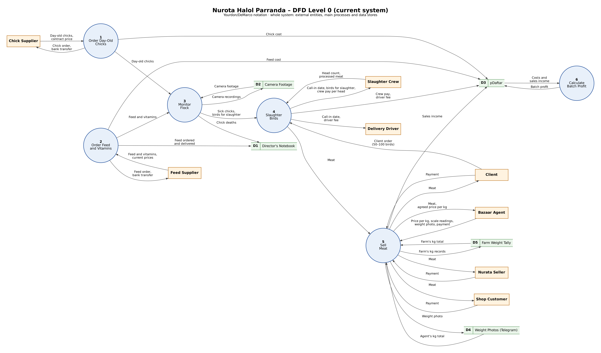
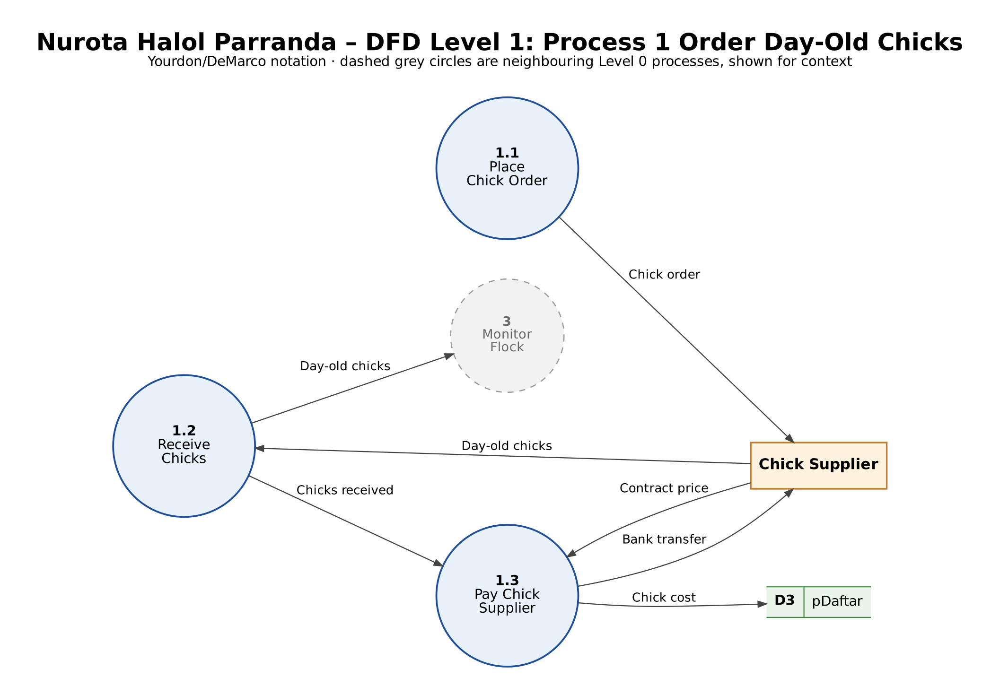
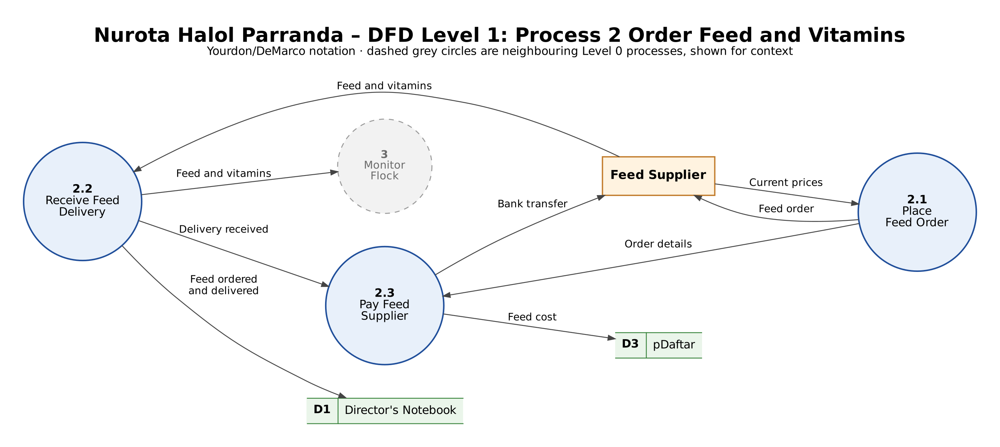
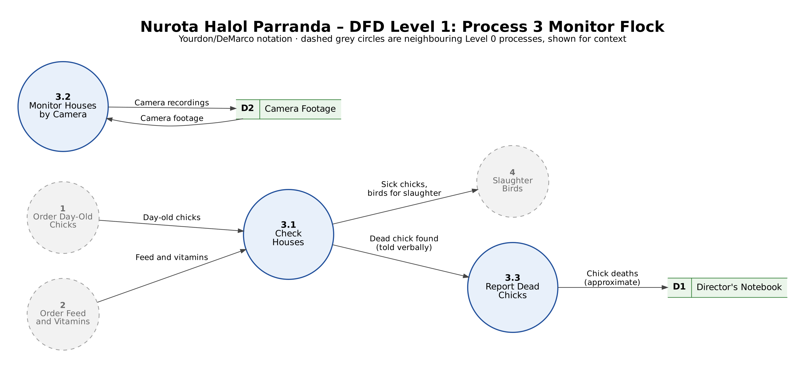
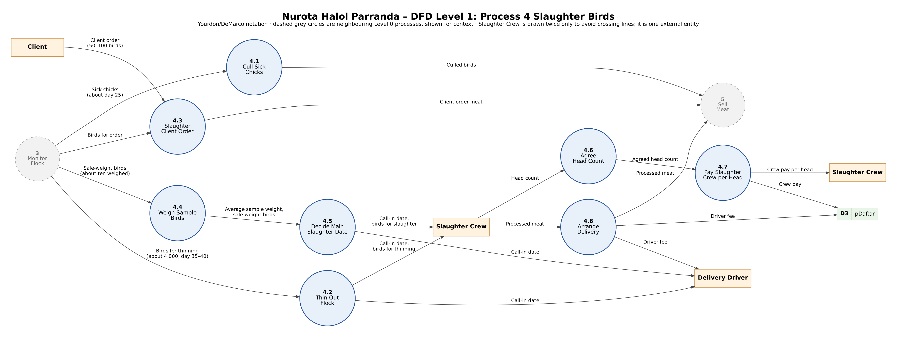
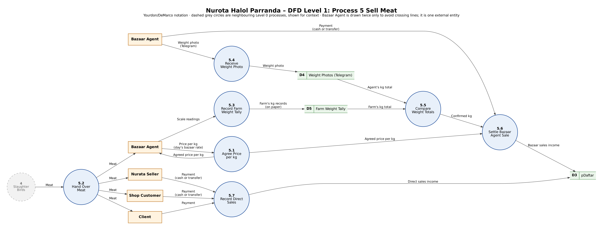

# Data Flow Diagram

The diagrams show how Nurota Halol Parranda handles its data today, without any computer system. The boundary is the farm itself. The Director, the Workers and the Director's brother, who records weights at the bazaar, carry out every process inside it, so none of them appears as an external entity. Outside are the two suppliers, the Slaughter Crew and the Delivery Driver who are hired for each slaughter, and four kinds of buyer: the Bazaar Agent, the Nurata Seller, the Shop Customer and the Client who places a small order. The Delivery Driver is not an actor in the use case diagram, but he is drawn here because the farm sends him a call-in date and a fee.

The farm's records end up in five places: the Director's paper notebook, the camera footage, the pDaftar app on his phone, the weight photos the Bazaar Agent sends on Telegram, and the paper tally the Director's brother keeps at the bazaar. None of them is linked to another. Live birds, feed and meat are drawn as flows where they move between processes, as in the module's own model answers, because each movement is also the moment a record is or is not made.

## Level 0

*Figure 4.1: DFD Level 0, the farm's current system*

Every money figure goes into pDaftar (D3). Processes 1, 2 and 4 add costs, process 5 adds sales income, and process 6 reads both back, works out the profit of a batch and stores it there too. The notebook (D1) holds only chick deaths and the feed that was ordered and delivered. Daily feed use is not tracked at all, and no process reads the notebook back, so the farm cannot see how much feed a batch really ate or what each bird cost to raise. The head count that sets the crew's pay comes in from the crew and is turned straight into a payment without being written down.

Process 6 is not broken down further, because it is one calculation made from figures already in pDaftar.

## Level 1: Process 1 Order Day-Old Chicks

*Figure 4.2: DFD Level 1, Process 1 Order Day-Old Chicks*

Ordering chicks splits into placing the order (1.1), receiving the chicks (1.2) and paying the supplier (1.3). The price is fixed by the standing contract, so the only figure from this process that reaches a store is the cost of the batch in pDaftar.

## Level 1: Process 2 Order Feed and Vitamins

*Figure 4.3: DFD Level 1, Process 2 Order Feed and Vitamins*

Feed follows the same pattern under the same contract: an order placed at the supplier's current prices (2.1), the delivery (2.2) and a bank transfer (2.3). Unlike chicks, each delivery is written in the notebook (2.2), and the cost goes into pDaftar (2.3). The two halves of the same delivery therefore end up in two separate stores, and nothing joins the quantity to the price.

## Level 1: Process 3 Monitor Flock

*Figure 4.4: DFD Level 1, Process 3 Monitor Flock*

Workers check each house every 15–30 minutes (3.1). When one of them finds a dead chick he tells the Director, who writes it in the notebook (3.3). The count passes through two people and a spoken message before it is written down, which is why the business case calls it approximate. The Director also watches the houses remotely through the camera app (3.2), but nothing he sees there is written down or passed to another process. Sick chicks and birds ready for slaughter leave this process for process 4.

## Level 1: Process 4 Slaughter Birds

*Figure 4.5: DFD Level 1, Process 4 Slaughter Birds*

Process 4 covers the use cases Cull Sick Chicks (4.1), Thin Out Flock (4.2), Slaughter Client Order (4.3), Weigh Sample Birds (4.4), Decide Main Slaughter Date (4.5, which also covers Postpone Slaughter), Pay Slaughter Crew per Head (4.6 Agree Head Count and 4.7) and Arrange Delivery (4.8). Run Main Slaughter has no process of its own because the hired Slaughter Crew carries it out, so it appears as the external entity. The Level 0 flow "birds for slaughter" splits here into the birds for thinning, for client orders and for the main slaughter.

Birds leave the houses in four ways. Around day 25 sick or stunted chicks are culled, killed and sold, and the cull itself leaves no record. Around day 35–40 the hired crew slaughters about 4,000 birds to thin the flock, and small client orders of 50–100 birds are slaughtered in-house whenever a client asks. For the main slaughter the Director weighs about ten birds and decides from their average whether to call in the crew and the driver now or wait three to five more days. Those sample weights are not written down anywhere.

Thinning and main-slaughter sessions end the same way. The crew reports how many birds it slaughtered, the Director accepts the count verbally (4.6) and pays the whole crew per head from it (4.7). Only the payment reaches pDaftar; the count behind it is never recorded, so a wrong count cannot be checked later. A driver is called in for every session, and his fee for taking the meat to the bazaar (4.8) goes into pDaftar as well.

## Level 1: Process 5 Sell Meat

*Figure 4.6: DFD Level 1, Process 5 Sell Meat*

The meat goes to four kinds of buyer (5.2), and only one of them is checked. The Bazaar Agent, an independent middleman who resells to seven to nine other sellers, takes the largest share, and his price per kg is agreed verbally at that day's bazaar rate (5.1). While he weighs the meat, the Director's brother reads the same scale at the same moment and writes every reading on paper (5.3), so the two records always agree. The agent's own totals arrive later as a photo on Telegram (5.4), the Director compares them with the brother's tally (5.5) and then settles the sale, the confirmed kilograms times the agreed price, which goes into pDaftar (5.6). The Nurata Seller and the Shop Customer have their meat weighed when they buy and pay in cash or by transfer, and Clients pay for their orders; their payments are recorded as direct sales in pDaftar (5.7). The only independent check on the farm's largest sales channel therefore depends on a family member standing next to the agent's scale.
