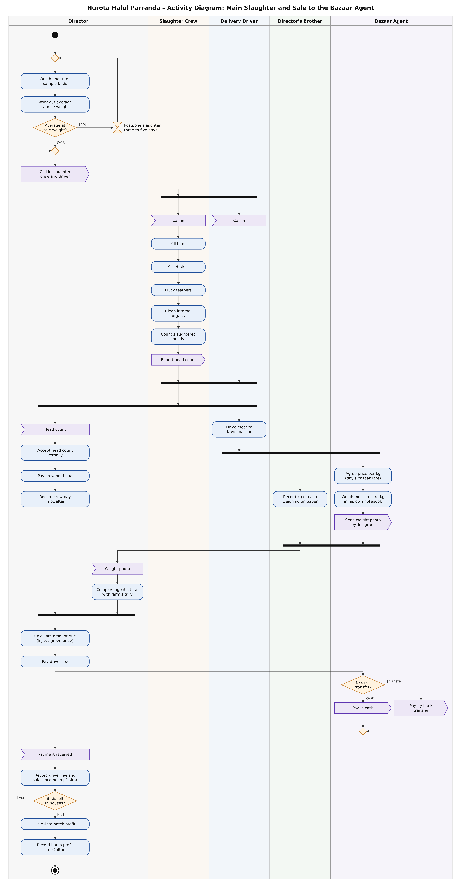

# Activity Diagram

The diagram follows the main slaughter of one batch and the sale of its meat to the Bazaar Agent. It shows that every figure the farm uses, the head count, the kilograms and the price, has to reach the Director before anything is paid or recorded. The day 35–40 thinning uses the same crew steps and is not repeated here. Sales to the Nurata Seller, the Shop Customer and Clients are left out because they are simpler: the meat is weighed when they buy and they pay in cash or by transfer. The Delivery Driver has his own lane even though he is not an actor in section 2, because the meat cannot reach the bazaar without him.

*Figure 5.1: Activity diagram, main slaughter and sale to the Bazaar Agent*

The decision to slaughter rests on about ten birds weighed by the Director, and their weights are never written down. A misjudged sample therefore cannot be traced afterwards, and it means either paying for extra days of feed or selling birds below weight. A low average simply postpones the slaughter by three to five days.

Once the crew has finished and reported its head count, two things happen at the same time, and both rely on trust rather than records. The Director accepts the count verbally and pays the whole crew per head on it, while the driver takes the meat to Navoi bazaar. There the price per kg is agreed at the day's bazaar rate, and as the agent weighs the meat and writes the kilograms in his own notebook, the Director's brother reads the same scale and writes each weighing on paper, which is the diagram's third fork. This is the only point in the process where the farm checks a figure given to it by someone outside, and it works only because a family member is standing at the scale.

The Director cannot work out what he is owed until the agent's photo arrives, so the money for each session waits on the agent. He compares the photo with his brother's tally, calculates the amount due and pays the driver. The agent then chooses whether to pay in cash or by bank transfer, and either way the sale is recorded in pDaftar together with the driver's fee. One session handles 1,000–1,200 birds, so the cycle repeats until no birds are left in the houses, and the profit of the batch is only known after the last session, too late to change anything during the slaughter.
