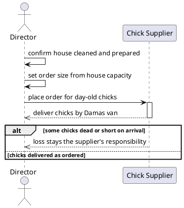
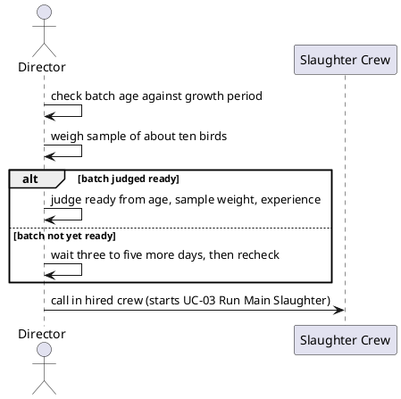
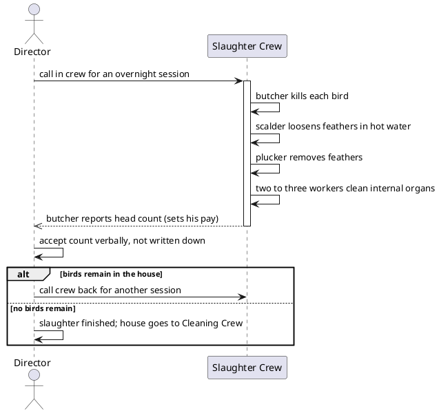
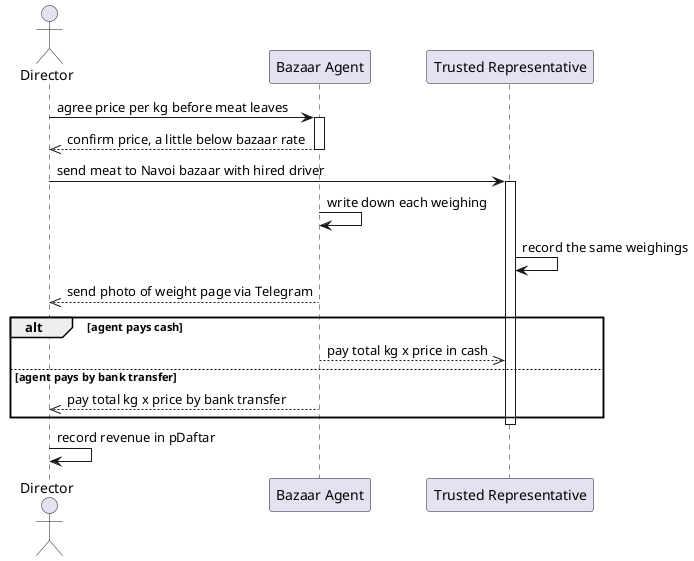

# Sequence Diagram

Each diagram traces to one of the four use cases in `3-use-cases.md`, reusing its actors and basic-flow order.

*Figure 6.1: UC-01 Order Day-Old Chicks*

*Figure 6.2: UC-02 Decide Main Slaughter Date*

*Figure 6.3: UC-03 Run Main Slaughter*

*Figure 6.4: UC-04 Sell Meat to Bazaar Agent*
