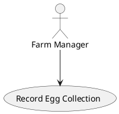

# SAD Coursework 1 — Group Report

This repo is a 4-person group's coursework report for **Systems Analysis and Design (6BUIS026C)** at WIUT. The full brief, with exact wording and the marking scheme, lives at `resources/md/Coursework-01-group-v2.md` — **read it before touching any section**, it's short (4 pages) and every section's requirement/points come straight from it.

## The business being analysed

A **broiler (poultry) farm** — a real local business (the repo owner's brother's farm), not a hypothetical case. The brief requires an existing local company; virtual/non-local businesses score 0.

## Who's doing what

- Repo owner: **Business Case** (`0-business-case.md`) + **Requirements Gathering Process** (`1-requirements-gathering-process.md`). They have direct insider access to the farm (family), useful for stakeholder interviews.
- The other 3 group members' assignments for sections 2–7 aren't recorded here yet — don't assume a split; ask if it matters for what you're doing.

## Key dates & constraints

- Submission deadline: **26-10-2026**. Results: **09-11-2026**.
- Group size must be **exactly 4** (not 3, not 5).
- Final submission is a **single Microsoft Word file**, named `SAD_CW1_STUDENTID.docx`, **not zipped**.
- Format: Arial 12, double-spaced, content page with page numbers, Westminster-Harvard referencing.

## Repository layout

```
0-business-case.md                  \
1-requirements-gathering-process.md  |
2-use-case-diagram.md                |  The 8 report sections. One file per
3-use-cases.md                       |  deliverable, in brief order. Each
4-data-flow-diagram.md               |  maps 1:1 to a rubric row.
5-activity-diagram.md                |
6-sequence-diagram.md                |
7-requirements-catalogue.md         /

resources/org/      Original downloaded course PDFs/ZIPs/MP4 (tracked in git as-is).
resources/md/       Markdown conversions of the above, for easy reading/grepping.
                     resources/md/Coursework-01-group-v2.md is THE brief — it was
                     manually re-verified against the PDF (tables/rubric fixed by
                     hand), trust it more than the other auto-converted files.
                     resources/md/tutorial 2.*/ hold extracted DFD case-study PNGs
                     (Threadz, Fresco, Natlib) referenced from tutorial 2.*.md.
resources/research/  Sourced research briefs produced by the `researcher` subagent,
                     one per section, created on demand — may not exist yet.

.claude/agents/      5 reusable subagents for this report (see below).
scripts/             Build pipeline scripts (diagram rendering, docx template).
tools/, .venv/, build/  Generated by `make` — gitignored, never hand-edit these.
```

## Writing a section: which subagent to reach for

All defined in `.claude/agents/`, usable by any of the 4 group members from this repo:

| Agent | Use it when... |
|---|---|
| `researcher` | Starting a section cold — gathers course material + web background into `resources/research/<section>-research.md` before you write. |
| `interview-coach` | Designing interview/survey questions for the farm, or writing up gathered evidence (section 1 especially). |
| `lecturer` | You're unsure how to produce a specific diagram/notation "the way this module teaches it" — answers strictly from `resources/md/` lecture & tutorial notes. |
| `rigorous-assessor` | After drafting/revising any section — predicts the mark against the exact rubric row and gives concrete, ranked fixes. Not encouraging by design; trust its number. |
| `consistency-checker` | Before merging/finalizing, or after any section changes — four people writing independently drift on actor/use-case/process names; this catches it. |

Typical flow for a section: `researcher` → write the section → `lecturer` if stuck on notation → `rigorous-assessor` to check it → `consistency-checker` once multiple sections exist.

## Diagram convention

Diagrams are **PlantUML**, as fenced code blocks directly inside the section markdown:

````

````

The compile pipeline renders these automatically. **Mermaid was deliberately not used** — `mermaid-cli` requires Puppeteer/Chromium (~250MB, fragile to install), while PlantUML is pure Java and already works here.

**DFDs are the exception**: PlantUML has no native DFD shapes (circle processes, open-ended data-store rectangles). For DFDs, either approximate with PlantUML, or draw externally (draw.io/Lucidchart) and embed as a plain image: ``-style path — the pipeline passes ordinary image links through untouched.

## Compiling the final Word document

```sh
make            # = make report → build/report.docx
make setup      # just (re)download pandoc + plantuml.jar + venv, no sudo needed
make clean      # remove build/ only
make distclean  # also remove the downloaded toolchain (tools/, .venv/)
```

`make report` does this, deterministically, every time:
1. Downloads `pandoc` (static binary) and `plantuml.jar` into `tools/` on first run (cached after).
2. `scripts/render_diagrams.py` concatenates the 8 section files in order, rendering every ` ```plantuml ` block to a cached PNG (by content hash — unchanged diagrams never re-render).
3. `scripts/build_reference_docx.py` builds `tools/reference.docx`: Arial 12, double-spaced body, page-number footer, each section starting on a new page.
4. `pandoc` combines everything into `build/report.docx` with an auto-generated Table of Contents field.

**After opening `build/report.docx` in Word**, select all (Ctrl+A) and press F9 to update the TOC and page numbers — pandoc inserts live fields, not baked-in values; this is normal, not a bug.

Nothing under `tools/`, `.venv/`, or `build/` is committed — they're fully regenerated by `make` from source files.

## Rubric cheat-sheet (100 points total)

| # | Section | Points |
|---|---|---|
| 0 | Business case | 10 |
| 1 | Requirements gathering process | 15 |
| 2 | Use Case Diagram | 10 |
| 3 | Use Cases (4 of them) | 15 |
| 4 | Data Flow Diagram | 10 |
| 5 | Activity Diagram | 10 |
| 6 | Sequence Diagram | 10 |
| 7 | Requirements Catalogue (5 functional + 5 non-functional) | 20 |

Exact sub-criteria and penalty clauses (e.g. -10 for no evidence of requirements gathering) are in the `# Assessment criteria/marking scheme` table of `resources/md/Coursework-01-group-v2.md` — `rigorous-assessor` already knows this table, consult it directly for anything not covered here.

## Conventions

- **Git commits in this repo omit the `Co-Authored-By` trailer** — don't add it unless explicitly asked again.
- Don't fabricate business facts about the farm (numbers, processes, stakeholder quotes) — if real data isn't available yet, say so in the section rather than inventing plausible-sounding detail; this is a graded analysis of a real business, not a case study.
