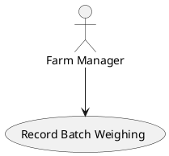

# SAD Coursework 1 — Group Report

This repo is a 4-person group's coursework report for **Systems Analysis and Design (6BUIS026C)** at WIUT. The full brief, with exact wording and the marking scheme, lives at `resources/md/Coursework-01-group-v2.md` — **read it before touching any section**, it's short (4 pages) and every section's requirement/points come straight from it.

## The business being analysed

A **broiler (poultry) farm** — a real local business (the repo owner's brother's farm), not a hypothetical case. The brief requires an existing local company; virtual/non-local businesses score 0.

## Who's doing what

| Student | Files | Section |
|---|---|---|
| Muzaffar (repo owner) | `0-business-case.md`, `1-requirements-gathering-process.md` | Business Case, Requirements Gathering Process |
| Abdurahmon | `2-use-case-diagram.md`, `3-use-cases.md` | Use Case Diagram, Use Cases |
| Nodir | `4-data-flow-diagram.md`, `5-activity-diagram.md` | Data Flow Diagram, Activity Diagram |
| Mirodil | `6-sequence-diagram.md`, `7-requirements-catalogue.md` | Sequence Diagram, Requirements Catalogue |

Muzaffar has direct insider access to the farm (family), useful for stakeholder interviews in section 1. New teammates/sessions: see `QUICKSTART.md` for a plain-language (EN/UZ) walkthrough.

## Key dates & constraints

- Submission deadline: **26-10-2026**. Results: **09-11-2026**.
- Group size must be **exactly 4** (not 3, not 5).
- Final submission is a **single Microsoft Word file**, named `SAD_CW1_STUDENTID.docx`, **not zipped**.
- Format: Arial 12, double-spaced, content page with page numbers, Westminster-Harvard referencing.

## Repository layout

The 8 numbered section files live flat in the repo root — see the "Who's doing what" table above for the list, or just `ls *.md`.

```
resources/org/      Original downloaded course PDFs/ZIPs/MP4 (tracked in git as-is).
resources/md/       Markdown conversions of the above, for easy reading/grepping.
                     resources/md/Coursework-01-group-v2.md is THE brief — it was
                     manually re-verified against the PDF (tables/rubric fixed by
                     hand), trust it more than the other auto-converted files.
                     resources/md/tutorial 2.*/ hold extracted DFD case-study PNGs
                     (Threadz, Fresco, Natlib) referenced from tutorial 2.*.md.
resources/research/  Sourced research briefs produced by the `researcher` subagent,
                     one per section, created on demand — may not exist yet.

.claude/agents/      5 reusable subagents for this report (see below).
scripts/             Build pipeline scripts (diagram rendering, docx template, section checks).
tools/, .venv/, build/  Generated by `make` — gitignored, never hand-edit these.
```

## Workflow: clarify → implement → run-tests → reviewer → auditor

Every section goes through this same 5-step order, every time, before it's considered done. Don't skip steps or reorder them — "run-tests" is deterministic and must pass before the two AI review steps, same as in a normal code workflow.

| # | Step | What it means for a report section | How |
|---|---|---|---|
| 1 | **Clarify** | Know the exact requirement/rubric row, and don't invent facts about the farm you don't actually have. | Read that section's requirement + rubric row in `resources/md/Coursework-01-group-v2.md`. If a real-world fact about the farm is missing, ask the person with access to it — don't guess. Optionally run `researcher` first to gather course + web background before writing. |
| 2 | **Implement** | Write/edit the section's numbered `.md` file. | Diagrams go in as ` ```plantuml ` fenced blocks (or an image link for DFDs, see Diagram convention). Use `interview-coach` while drafting section 1. Apply the `analytical-writing` skill (`.claude/skills/analytical-writing/`) to your draft — the brief requires analytical, not descriptive, prose outside the Business Case section. |
| 3 | **Run-tests** | Deterministic, non-AI checks — hard constraints only (word limits, diagram presence, diagrams actually render). | `make check` — must exit 0 before moving on. If it fails, fix and re-run; don't send a failing section to the reviewer. |
| 4 | **Reviewer** | Cross-section consistency — does this section's names/facts agree with everyone else's sections? | Run the `consistency-checker` subagent. Fix anything it flags. |
| 5 | **Auditor** | Predicted grade against the actual marking scheme — the strict final gate. | Run the `rigorous-assessor` subagent. It is not encouraging by design; treat its score as real and its fixes as the to-do list. Loop back to step 2 until you're deliberately okay with the gap, if any. |

`make check` is the only step that isn't an AI subagent call — it's a plain script (`scripts/check_section.py`) so "does this pass" is always an unambiguous yes/no, not a judgment call. It currently checks: business case ≤500 words, diagram sections (2/4/5/6) contain a renderable diagram, requirements catalogue (7) has a table. It does **not** check content quality or rubric nuance — that's steps 4–5.

### All 5 subagents at a glance

Defined in `.claude/agents/`, usable by any of the 4 group members from this repo:

| Agent | Workflow step | Use it when... |
|---|---|---|
| `researcher` | Clarify | Starting a section cold — gathers course material + web background into `resources/research/<section>-research.md` before you write. |
| `interview-coach` | Implement | Designing interview/survey questions for the farm, or writing up gathered evidence (section 1 especially). |
| `lecturer` | Implement | You're unsure how to produce a specific diagram/notation "the way this module teaches it" — answers strictly from `resources/md/` lecture & tutorial notes. |
| `consistency-checker` | Reviewer | Before merging/finalizing, or after any section changes — four people writing independently drift on actor/use-case/process names; this catches it. |
| `rigorous-assessor` | Auditor | After `make check` passes — predicts the mark against the exact rubric row and gives concrete, ranked fixes. |

### Getting started on a section, concretely

```
1. Open resources/md/Coursework-01-group-v2.md, read your section's requirement + rubric row.
2. (optional) Ask the researcher subagent to brief you on it.
3. Write N-section-name.md.
4. make check                      # must pass
5. Ask the consistency-checker subagent to review it against the other sections.
6. Ask the rigorous-assessor subagent to predict its mark.
7. Fix what it flags, repeat 4-6 until you accept the result.
```

## Diagram convention

Diagrams are **PlantUML**, as fenced code blocks directly inside the section markdown:

````

````

The compile pipeline renders these automatically. **Mermaid was deliberately not used** — `mermaid-cli` requires Puppeteer/Chromium (~250MB, fragile to install), while PlantUML is pure Java and already works here.

**DFDs are the exception**: PlantUML has no native DFD shapes (circle processes, open-ended data-store rectangles). For DFDs, either approximate with PlantUML, or draw externally (draw.io/Lucidchart) and embed as a plain image: ``-style path — the pipeline passes ordinary image links through untouched.

## Compiling the final Word document

```sh
make            # = make report → build/report.docx
make check      # run-tests step - deterministic section checks, see Workflow above
```

Full pipeline details, `make setup`/`clean`/`distclean`, and the Word "Ctrl+A then F9" gotcha after opening `build/report.docx`: see the `compile-report` skill.

## Rubric cheat-sheet (100 points total)

| # | Section | Points |
|---|---|---|
| 0 | Business case | 10 |
| 1 | Requirements gathering process | 15 |
| 2 | Use Case Diagram | 10 |
| 3 | Use Cases (4 of them) | 15 |
| 4 | Data Flow Diagram | 10 |
| 5 | Activity Diagram | 10 |
| 6 | Sequence Diagram | 10 |
| 7 | Requirements Catalogue (5 functional + 5 non-functional) | 20 |

Exact sub-criteria and penalty clauses (e.g. -10 for no evidence of requirements gathering) are in the `# Assessment criteria/marking scheme` table of `resources/md/Coursework-01-group-v2.md` — `rigorous-assessor` already knows this table, consult it directly for anything not covered here.

## Conventions

- **Git commits in this repo omit the `Co-Authored-By` trailer** — don't add it unless explicitly asked again.
- Don't fabricate business facts about the farm (numbers, processes, stakeholder quotes) — if real data isn't available yet, say so in the section rather than inventing plausible-sounding detail; this is a graded analysis of a real business, not a case study.
