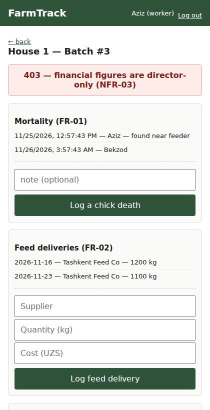
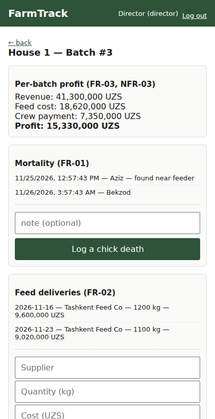
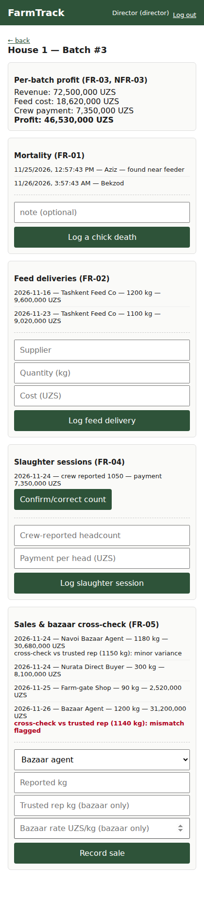

# Solution Prototypes

Both prototypes implement FarmTrack, scoped to the five requirements CW1's
catalogue already treats as fixed and fully elicited — FR-01 (mortality
logging), FR-02 (feed delivery recording), FR-03 (per-batch profit), FR-04
(slaughter crew head count), FR-05 (bazaar agent cross-check) — plus
NFR-01, NFR-02, NFR-03 and NFR-05. FR-06–09 (voice entry, environment
monitoring, remote lighting, flock density) depend on hardware and AI
validation that has not happened yet, so building them now would mean
guessing at an interface for a capability nobody has confirmed is feasible;
they appear only as planned packages in the architecture diagram
(`2-uml-class-diagram.md`).

## Low-fidelity prototype

`prototype-lowfi/01-login.html` — five screens, grayscale, linked by real
`<a>` navigation rather than static images, so the role split that drives
NFR-03 could be checked before any code was written: the worker's batch
screen (`04-batch-worker.html`) never renders a profit figure at all, while
the director's screen (`05-batch-director.html`) shows the same batch with
the profit panel present. Validating that split at wireframe stage is
cheaper than discovering in the executable build that a worker's view
needs a financial field stripped back out.

## High-fidelity prototype

`prototype-highfi/` — an executable Node.js app (`node server.js`, no
external dependencies), run and recorded for this submission at
`http://localhost:4100`. The domain classes (`House`, `Batch`,
`MortalityRecord`, `FeedDelivery`, `SlaughterSession`, `SaleRecord`, the
`User`/`Buyer` hierarchies) are the same classes diagrammed in
`2-uml-class-diagram.md` — the prototype is the diagram's implementation,
not a separate exercise.

NFR-03 (director-only financial visibility) is enforced on the server, not
just hidden in the browser: `GET /api/batches/:id/profit` returns `403`
for a worker session, and `/api/state` strips `costUzs`, `pricePerKg` and
`profitUzs` fields from the JSON itself before it reaches the worker's
browser. Hiding these fields only in the UI would still leave them
visible in the browser's network inspector — not acceptable given the
director currently declines to share the notebook or pDaftar with anyone,
workers included.

| Requirement | Prototype feature |
|---|---|
| FR-01 | Mortality log; a second worker logging a death for the same batch within the same couple of minutes is flagged as a possible duplicate rather than counted twice |
| FR-02 | Feed delivery log tied to a specific batch, with feed-per-remaining-bird calculated from it |
| FR-03 | Profit computed per open batch (revenue − feed cost − crew payment), not pooled across houses |
| FR-04 | Slaughter session records the crew's reported head count; the director can later confirm or correct it with a note |
| FR-05 | A sale can carry both the buyer's reported kg and the Trusted Representative's own weighing; a >3% gap is flagged `mismatch_flagged` automatically |
| NFR-05 | Houses and batches are configuration data, not code — a director can add a house at runtime |

### Screenshots

### Code and screencast

- Code: [`prototype-highfi/`](../prototype-highfi/) (see `prototype-highfi/README.md` for the run instructions and the full requirement-to-code mapping).
- Low-fidelity wireframes: [`prototype-lowfi/`](../prototype-lowfi/), starting at `01-login.html`.
- Screencast: [`prototype-highfi/demo.mp4`](../prototype-highfi/demo.mp4) (17 seconds, within the 1-minute limit). It logs in as a worker and shows the mortality log with financials hidden, then logs in as the director and shows the profit panel and the bazaar cross-check flag from the table above.

**[TO DO before submission: replace the three relative links above with the
GitHub URLs once this is pushed, since the submission itself is a single
.docx and cannot carry the code or video as attached files.]**
