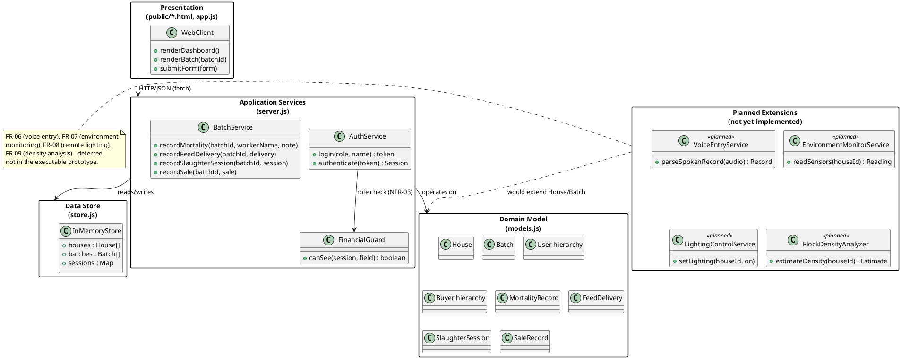
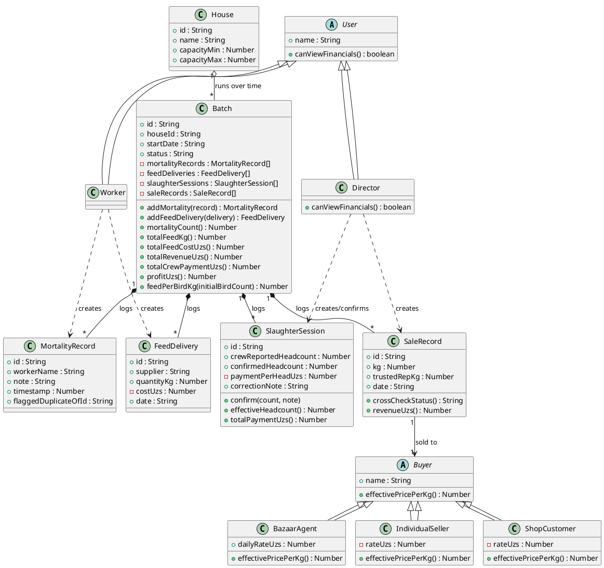

# UML Class Diagram

FarmTrack's class model implements the core record-keeping requirements
already fixed by CW1's catalogue (FR-01–05, NFR-01/02/03/05); the
IoT/voice/vision requirements (FR-06–09) are shown only as planned,
unimplemented packages, since they depend on hardware and AI validation not
yet carried out. Both diagrams reflect the prototype's actual code
(`prototype-highfi/models.js`, `server.js`), not an idealised design drawn
separately from it.

## Architecture Diagram (packages and sub-systems)

## Detailed Class Diagram (core record-keeping module)

Relationship types used: **generalization** (`User`→`Director`/`Worker`,
`Buyer`→its three subtypes), **composition** (`Batch` owns its mortality,
feed, slaughter and sale records — none of these exist independently of
the batch they belong to), **aggregation** (`House` has `Batch`es across
successive production cycles, but a `Batch` is meaningful on its own record
once closed), **association** (`SaleRecord`→`Buyer`, since a buyer exists
independently of any one sale), and **dependency** (`Worker`/`Director`
creating specific record types, reflecting the role split in NFR-02/NFR-03).
