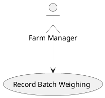

# QUICKSTART

One rule: **touch only your two files.** Everything else below is the exact process, in order, every time.

## What we're analyzing

We are analyzing a **broiler farm belonging to Muzaffar's brother.** It's a real business, not a made-up case study — don't invent facts about it.

If you have any question about how the farm actually works (processes, people, numbers, day-to-day operations) — **ask Muzaffar.** He is the proxy to get real answers from the farm. Don't guess.

## Who's responsible for which section

| Student | File 1 | File 2 |
|---|---|---|
| Muzaffar | `0-business-case.md` | `1-requirements-gathering-process.md` |
| Abdurahmon | `2-use-case-diagram.md` | `3-use-cases.md` |
| Nodir | `4-data-flow-diagram.md` | `5-activity-diagram.md` |
| Mirodil | `6-sequence-diagram.md` | `7-requirements-catalogue.md` |

## Don't know where to start?

Tell Claude, exactly:
```
Use the researcher subagent to gather background for <your-file>.
```
It reads the relevant course lecture/tutorial notes and does web research for that specific section, then writes you a briefing before you write anything. Use this first if you're stuck.

## Available custom subagents

| Subagent | Example use-case |
|---|---|
| `researcher` | `Use the researcher subagent to gather background for 4-data-flow-diagram.md.` |
| `lecturer` | `Use the lecturer subagent to explain how to draw a DFD level 1 diagram, the way this module teaches it.` |
| `interview-coach` | `Use the interview-coach subagent to help me write interview questions for the farm workers.` |
| `consistency-checker` | `Use the consistency-checker subagent to check 3-use-cases.md against the other report section files.` |
| `rigorous-assessor` | `Use the rigorous-assessor subagent to grade 3-use-cases.md against the marking scheme.` |

## The process

Do these steps in this exact order. Do not skip step 4 or step 5/6.

**1. Read your requirement.**
Open `resources/md/Coursework-01-group-v2.md`. Find the `## Requirements` numbered item and the matching row in the `# Assessment criteria/marking scheme` table for each of your two files. That row is exactly what you're being graded against — nothing else.

**2. Write your content directly into your two files.**
No Word, no Google Docs, no draw.io file — write in the `.md` file itself. Keep the existing `# Heading` line at the top. The brief requires analytical writing, not descriptive/explainy text — run the `/analytical-writing` skill on your draft before moving on (or just ask Claude to "apply the analytical-writing skill to this section").

**3. If your file needs a diagram, write it as a PlantUML code block,** exactly in this form:

````

````

(DFD files — `4-data-flow-diagram.md` — are the one exception: if PlantUML can't draw the proper DFD shapes, draw it in an external tool and embed it as `` instead.)

**4. Run the automatic check. This must pass before anything else.**
```
make check
```
Expected last line: `All deterministic checks passed.`
If you instead see any line starting with `FAIL`, fix that exact issue and run `make check` again. Do not proceed to step 5 while any `FAIL` line is showing.

**5. Ask Claude to run the reviewer, using this exact sentence** (replace `<your-file>` with your actual filename, e.g. `2-use-case-diagram.md`):
```
Use the consistency-checker subagent to check <your-file> against the other report section files.
```
Fix every issue it reports (usually: a name/actor/process that doesn't match what another file calls it).

**6. Ask Claude to run the auditor, using this exact sentence:**
```
Use the rigorous-assessor subagent to grade <your-file> against the marking scheme.
```
It will give you a predicted score out of the row's total points and a ranked list of fixes. Make the fixes.

**7. Repeat steps 4 → 5 → 6 until you accept the score.** This is not optional — a section that hasn't been through all three is not done, regardless of how finished it looks.

---

Everything else (full rules, compiling the whole report into docx, rubric details): `CLAUDE.md`. The actual brief and marking scheme: `resources/md/Coursework-01-group-v2.md`.
